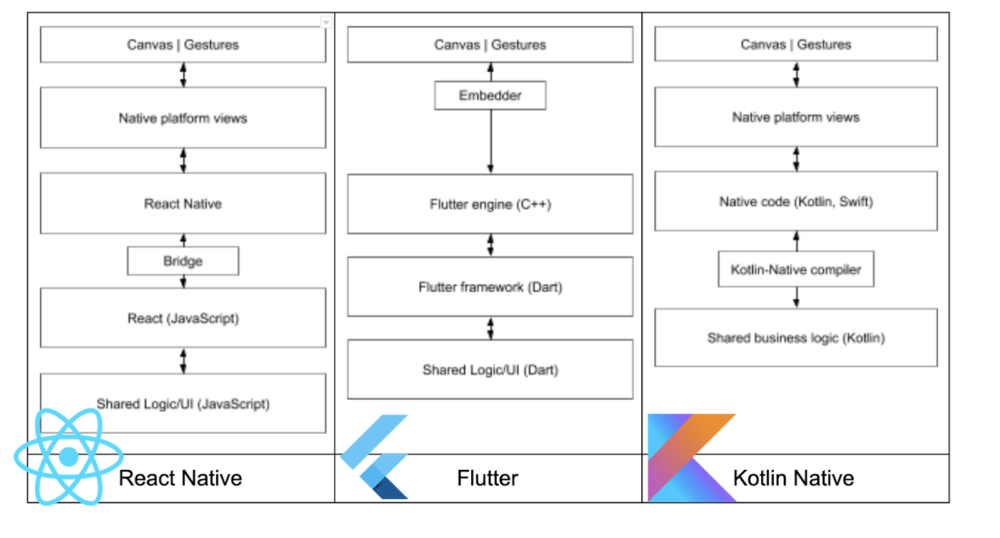

# Flutter

## What is it, and how does it work?

Content presented in April 2020 (approximate date).

---

# What is Flutter?

A framework that uses Dart to develop mobile, web, and desktop apps.

---

# How does it work?

---

# Why does Flutter use Dart?

<v-clicks>

- Strongly typed language (but not entirely; it can be configured)
- Ahead-of-time compilation (for production)
- Just-in-time compilation (for development)
- Object-oriented, with asynchronous functions
- It also has an RX package for a strongly functional approach
- Dart can also produce JavaScript for web applications

</v-clicks>

---

# Widgets

The Google team created many widgets — components, in React terms — ranging from text to a draggable bottom menu.

---

# Libraries

Dart and Flutter have a library registry similar to npm called pub.dev.

---

# Pros

<v-clicks>

- Performance
- Upgrades
- Lots of widgets
- Active community
- Google support
- Easy screen creation
- Shadows work on both iOS and Android
- Implicit and explicit animations
- Your UX/UI designer will be happy

</v-clicks>

---

# Cons

<v-clicks>

- A somewhat steep learning curve (yes, somewhat)
- Nested code
- Google support
- React is still better when it comes to screen code
- Development performance

</v-clicks>

---

# What about React Native?

## Is Flutter better?

---

# That's it

