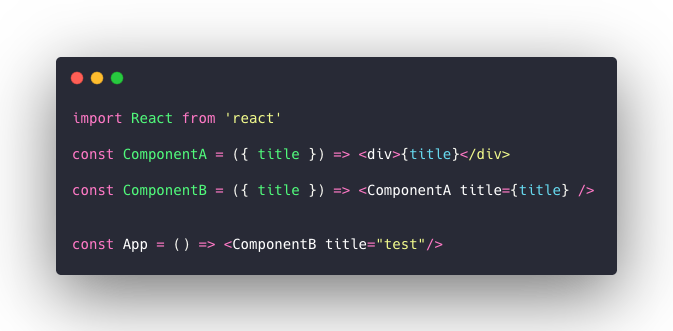
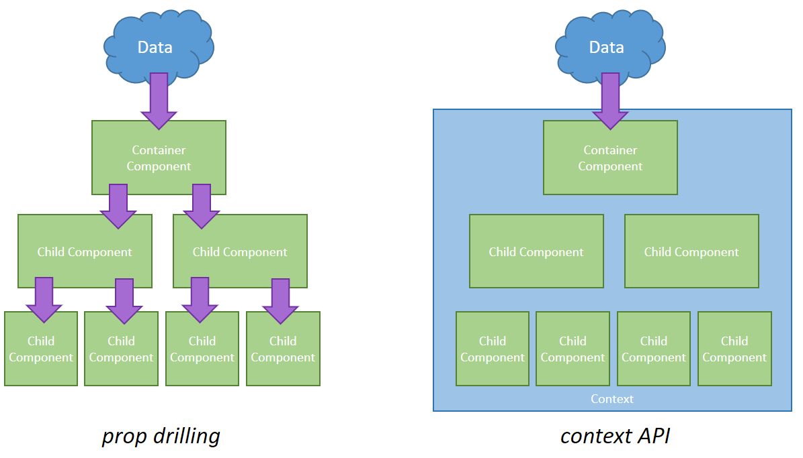
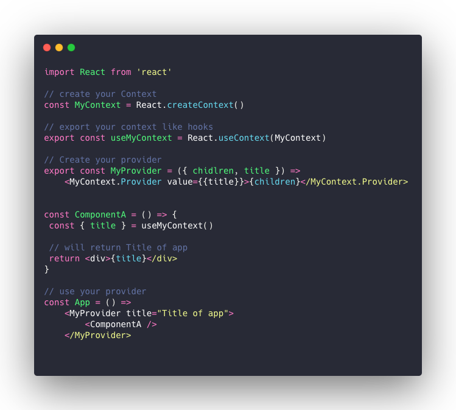
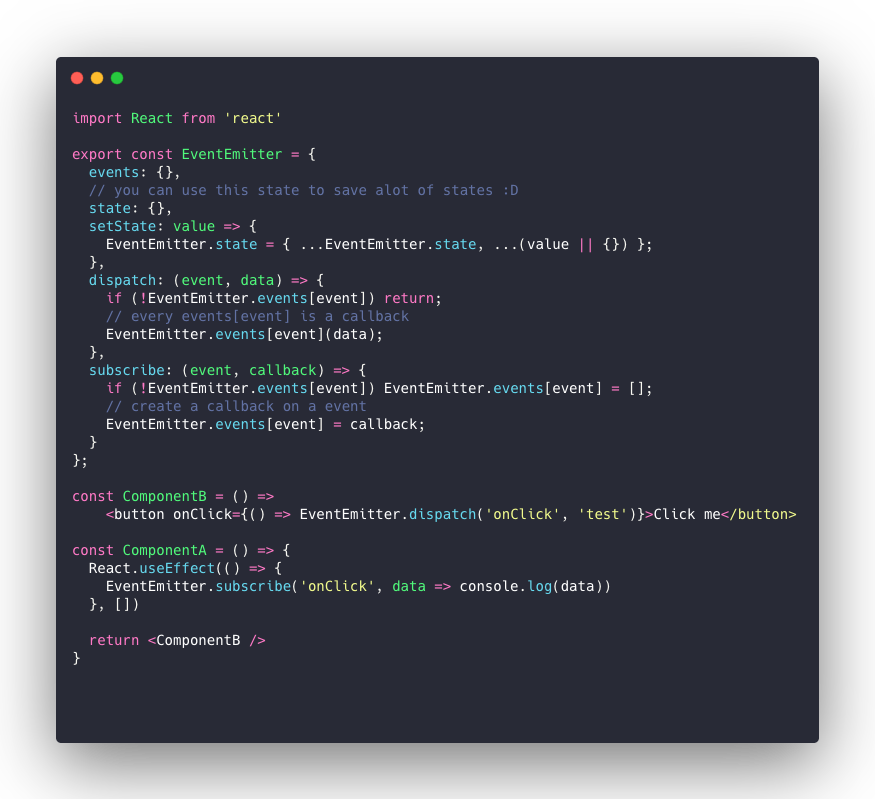

# State Management

## What is it, and what are the options?

Content presented in January 2020 (approximate date).

---

# What is state management?

As the name suggests, it is the management of an application's state. This presentation focuses on React web and React Native applications.

---

# What is state?

In a React application, state is basically a variable that holds data for a component.

---

# Why do we need to manage state?

Many components can have state, and that state often needs to be reused. That is where state management comes in.

---

# What options do we have?

<v-clicks>

- Redux/MobX
- Context API with hooks
- Event Emitter
- Or passing state through props, from component to component

</v-clicks>

---

# Props — how do we use them?

---

# Props — pros

<v-clicks>

- Simple and direct
- It can be ideal for a calculator

</v-clicks>

---

# Props — cons

<v-clicks>

- Potential duplicate props
- Many re-renders
- Difficult maintenance
- Props drilling

</v-clicks>

---

# Props drilling

Props drilling happens when you pass props with the same instance through several components. When state updates, this can cause a chain reaction and many unnecessary re-renders.

---

# Redux

Redux was created to address the props drilling problem. But how?

---

# Redux — props drilling

---

# Redux — how do we use it?

<v-clicks>

- Create a provider
- Create the types
- Create the reducers
- Create the actions
- Once all of that exists…
- Call our function or prop in the component through `connect`

</v-clicks>

---

# Redux — pros

<v-clicks>

- Single source of truth
- Centralized state
- Error handling
- Ability to create side effects
- Debugging with DevTools

</v-clicks>

---

# Redux — cons

<v-clicks>

- Strong dependency on a library
- Code must be very well structured to work well
- Complexity when creating new functions
- Side effects…

</v-clicks>

---

# Context API

As the name suggests, it is part of React core and provides a way to create a context for sharing state or functions.

---

# Context API

Redux itself uses the Context API to communicate props between components. So why not use it in its purest form?

---

# Context API — how do we use it?

---

# Context API — pros

<v-clicks>

- Full control over the context
- Easy to create
- No external library required

</v-clicks>

---

# Context API — cons

<v-clicks>

- Full responsibility rests with the developer
- Extra attention to application re-renders

</v-clicks>

---

# Event Emitter

Event emission is common on the backend, often handled masterfully by Apache Kafka, or through reactive language features such as RxJava.

---

# Event Emitter

There are several ways to create an Event Emitter, but there is one very simple way to apply event emission between components.

---

# Event Emitter — how do we use it?

---

# Event Emitter — pros

<v-clicks>

- We can create side effects more easily
- Complete freedom in managing state and side effects
- Simple and easy to maintain

</v-clicks>

---

# Event Emitter — cons

<v-clicks>

- Full responsibility rests with the developer
- Difficult to document (at least for now)
- It can be harder for new developers to understand the project

</v-clicks>

---

# That's it

## Questions?
