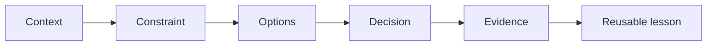

# Engineering Talks

## Sharing engineering decisions

Technical ideas become more valuable when people can understand, question, and reuse them.

<div class="mt-12 text-sm opacity-70">A native Slidev presentation · 2026</div>

---

layout: statement
---

# The audience should understand why a decision worked and when to apply the same reasoning

---

layout: two-cols-header
---

# A concrete starting point

::left::

### Weak starting point

> “Today I will explain our architecture.”

- No clear audience
- No decision to illuminate
- No practical destination

::right::

### Strong starting point

> “Deployments take 45 minutes, and nobody knows which check is slowing us down.”

- Observable constraint
- Shared stakes
- A question worth answering

---

# The reasoning behind a decision



The implementation matters. The reasoning is what travels to another team.

---

# Evidence people can inspect

```ts {1-4|6-9|all}
type Deployment = {
  startedAt: Date;
  finishedAt: Date;
};

export function durationInMinutes(deployment: Deployment): number {
  const milliseconds = deployment.finishedAt.getTime() - deployment.startedAt.getTime();
  return milliseconds / 60_000;
}
```

Examples should be small enough to inspect and honest enough to trust.

---

layout: two-cols
---

# The live presentation

- One idea per slide
- High-contrast visual hierarchy
- Code readable from the back
- Alternatives described fairly
- Time reserved for questions

::right::

# Value after the talk

- Links with stable destinations
- Context alongside conclusions
- Searchable metadata
- Reproducible examples
- A clear source repository

---

# A durable publishing loop

1. Capture the problem and audience.
2. Turn decisions into a coherent story.
3. Validate examples and claims.
4. Present, listen, and learn.
5. Publish the improved artifact.

<div class="callout mt-10">Each presentation creates feedback that improves the published material.</div>

---

layout: center
class: text-center
---

# Reusable reasoning

Make the next engineering decision easier.

<div class="mt-10 text-sm opacity-70">github.com/DavidDimon/engineering-talks</div>
